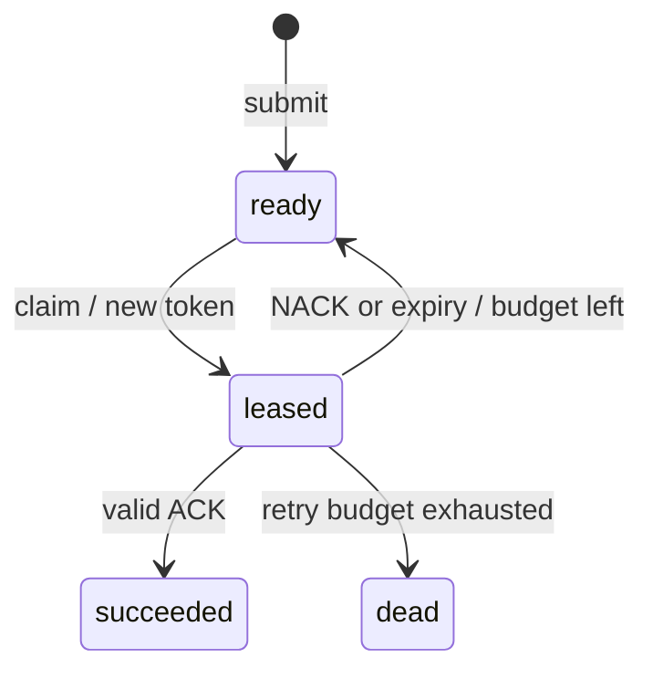

# LeaseQueue · C++20

[](https://github.com/ASimonyan1/leasequeue-cpp/actions/workflows/cpp.yml)

**Повторить работу можно. Принять устаревший результат — нельзя.**

Потокобезопасная очередь фоновых заданий: аренда на время обработки, поколения аренды, повторные попытки, восстановление из журнала. Библиотека, пример с четырьмя обработчиками и контрактные тесты. Без внешних библиотек.

## Сценарии отказа

| Ситуация | Поведение |
|---|---|
| Несколько нитей забирают задачу | Только одна получает действующую аренду |
| Старый обработчик отвечает после срока | ACK/NACK отвергается по token и дедлайну |
| Клиент повторяет создание | Прежний ID для того же ключа и payload |
| Исчерпан бюджет попыток | Переход в dead |
| Ошибка записи журнала | Состояние не подменяется; объект закрыт для операций до восстановления |
| Обрыв записи | Незавершённый хвост отбрасывается; повреждённый полный record вызывает ошибку |

## Сборка

CMake 3.20+ и GCC/Clang/MSVC с C++20:

```sh
cmake -S . -B build -DCMAKE_BUILD_TYPE=Debug
cmake --build build --config Debug --parallel 2
ctest --test-dir build -C Debug --output-on-failure
./build/queue_demo demo.wal
./build/queue_demo demo.wal
```

Windows/MSVC: `build/Debug/queue_demo.exe`. Оба запуска печатают `succeeded=20 ready=0 leased=0 dead=0`: повтор не создаёт ещё 20 задач.

```cpp
auto journal = std::make_shared<leasequeue::FileJournal>("jobs.wal");
leasequeue::Queue queue(journal);
auto id = queue.submit("reminder:42", "Send reminder", 1000);
auto lease = queue.claim(1000, 30000);
if (lease) {
    // Внешний эффект обработчика должен дедуплицироваться по job.id.
    queue.ack(id, lease->token, 1100);
}
```

Время задаётся явно в миллисекундах; тесты обходятся без sleep. Дедлайн исключительный: ACK при now == lease_until отвергается. NACK задаёт задержку следующей попытки. Истёкшие аренды обрабатываются при claim, отдельного таймера нет.



## Проверки

Десять групп контрактов: идемпотентность, граница срока, fencing, backoff и бюджет, restart с бинарным payload, отказ записи, восемь конкурентных обработчиков, конкурентное создание одного ключа, неверное время, повреждение/обрыв журнала и последовательность записей. Тесты не полагаются на отключаемый assert.

CI: Linux и Windows; AddressSanitizer + UBSan отдельной сборкой. ThreadSanitizer можно включить локально через `-DENABLE_TSAN=ON`, отдельно от ASan.

## Границы реализации

Учебное ядро, не распределённый брокер. Один процесс владеет файлом, несколько нитей работают внутри. Транзакция сохраняет полный снимок: O(N) по количеству задач плюс объём payload; журнал растёт без компактации. Capacity включает завершённые задачи. Replay пока читает все записи в память.

Flush передаёт запись ОС, но **не гарантирует сохранность при отключении питания**. FNV-1a обнаруживает случайные повреждения, но не защищает от подмены. После аварии .lock-каталог может потребовать ручного удаления, предварительно убедившись, что другого процесса нет. Скачки системных часов меняют фактическую длительность lease. Exactly-once внешние эффекты не обещаются.

[Дизайн и гарантии](docs/DESIGN.md) · [Разбор кода](docs/WALKTHROUGH.md)
